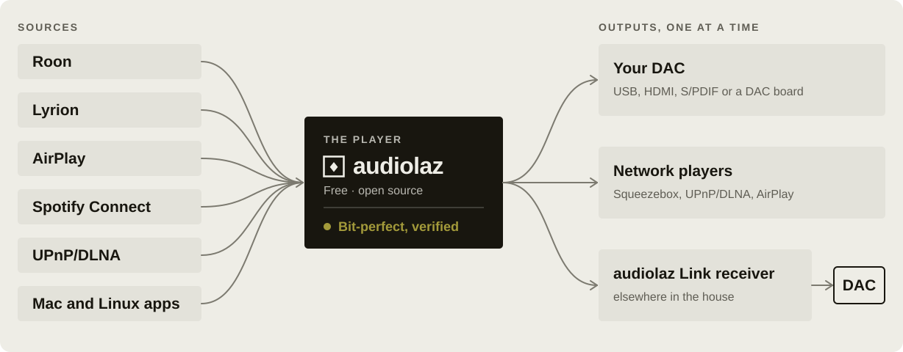
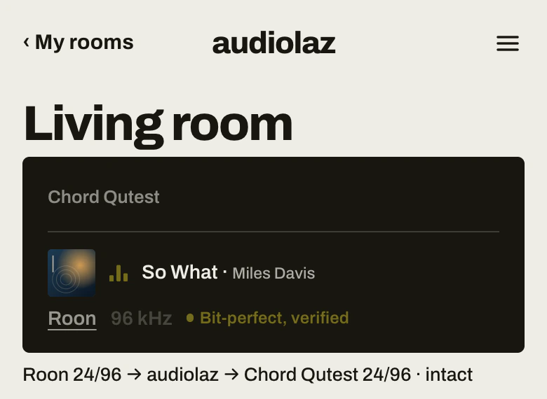

<p align="center">
  <picture>
    <source media="(prefers-color-scheme: dark)" srcset="docs/img/logo-dark.svg">
    
  </picture>
</p>

<p align="center">
  <a href="LICENSE"></a>
  <a href="src/linux/kmod/COPYING"></a>
  
  
</p>

# audiolaz — free audio player, audiolaz Link and drivers

A Swiss army knife for audio streams on your network: one small program takes music from the sources you already use,
sends it to the outputs you already have, and leaves it **exactly as it came**. It tells you so: *bit-perfect,
verified*.

<p align="center">
  <picture>
    <source media="(prefers-color-scheme: dark)" srcset="docs/img/player-dark.svg">
    
  </picture>
</p>

This repository holds the free and open-source parts of [audiolaz](https://audiolaz.com):

| Folder | What it is |
| --- | --- |
| `src/player/` | **The audiolaz player** (`audiolaz-player`): inputs, outputs, network streaming, its own web page and `/state` |
| `src/player/audiolaz-recv.c` | **audiolaz Link receiver** (`audiolaz-recv`): the small program beside the DAC |
| `src/linux/` | **The audiolaz sound card for Linux** (`snd-audiolaz`, a kernel module, GPL-2.0) and the Link scripts |
| `src/player/pcm_azdrv.c` | The `audiolaz` ALSA output plug-in: any Linux app plays into the player |
| `src/mac/driver/` | **The audiolaz output for macOS** (a Core Audio HAL plug-in): every app of the Mac plays into the player |
| `docs/` | The protocols and formats: audiolaz Link, the player's control file and page, the bit-perfect check |
| `tests/` | The tests, runnable on any Linux machine (no sound card needed) |

## What the player does

**Inputs** — Roon (as a Squeezebox player: Roon's own Squeezebox support, nothing to install on the Core), Lyrion /
Logitech Media Server, AirPlay (with [shairport-sync](https://github.com/mikebrady/shairport-sync)), Spotify Connect
(with [librespot](https://github.com/librespot-org/librespot)), a built-in UPnP/DLNA renderer, any Linux application
through the `audiolaz` sound card or ALSA output, every app of a Mac through the `audiolaz` output. When several play,
the one that started last plays.

**Outputs** — any ALSA card on Linux, any Core Audio device on macOS (exclusive mode when asked), Squeezebox players
(squeezelite, piCorePlayer…), UPnP/DLNA renderers, AirPlay devices (through
[squeeze2raop](https://github.com/philippe44/LMS-Raop)), and **audiolaz Link** receivers.

**Nothing changed on the way** — no resampling, no volume of its own, no processing. Only what an output needs to play
at all is done, and said on the page as *a conversion needed for this device*:

- a rate the device does not accept: the nearest one it takes (the output layer's conversion);
- a word length the output does not keep (a 32-bit source to a 24-bit DAC): requantized once, with TPDF dither (a
  16- or 24-bit source is left untouched);
- a source of more than two channels to a stereo output: its first two channels (a mono source: on both).

**Your speakers** — left and right swapped (the music itself, as it comes in), or the polarity of the speaker on one
output channel inverted (a cable connected the wrong way round), from the player's page or `POST /channels`: every sample moved or negated exactly, nothing recalculated, and the page
says *lossless* instead of bit-perfect while it is on.

**Bit-perfect, verified** — while it plays, the player fingerprints every frame that comes in and every frame it hands
to the output, span by span, and compares them (about 0.2 % of one core at 192 kHz). Its page and `GET /state` say
`"bitPerfect": true` only when every span compared was identical, `false` with the reason otherwise, and the sound's
path (source, format in, format out, output, DAC). See [docs/BIT-PERFECT.md](docs/BIT-PERFECT.md).

<p align="center">
  <picture>
    <source media="(prefers-color-scheme: dark)" srcset="docs/img/player-page-dark.webp">
    
  </picture>
</p>

Also: AirPlay video's lip sync (the player announces its own latency to the sender), the title, artist and cover sent
to receivers with a screen, and playback of a measurement sweep the app asks for (measuring a room is free).

## audiolaz Link

A free, open audiophile network transport. The computer does the work, far from the DAC; a small receiver beside the
DAC (a Raspberry Pi, a streamer) takes the music in small, perfectly regular packets and plays it as it came, **paced
by the DAC's own clock**: the receiver reports what the DAC actually played, and the sender follows it. No resampling,
no buffer bloat: the receiver's reserve is sized by the network's measured jitter, and grows or shrinks only with
digital silence, never by touching a sample. One DAC, one player: a second player is told who is playing.

The protocol is documented in [docs/LINK-PROTOCOL.md](docs/LINK-PROTOCOL.md) so that anyone can write a sender or a
receiver for it.

## Build

Linux (Debian, Ubuntu, Raspberry Pi OS, Arch…): `gcc`, `make`, the ALSA headers (`libasound2-dev` / `alsa-lib`),
the FLAC headers (`libflac-dev` / `flac`), `python3` for the tests. macOS 13.5 or later: the Xcode command line tools.

```sh
./build.sh              # build/audiolaz-player, build/audiolaz-recv (Linux), build/libasound_module_pcm_audiolaz.so (Linux)
./build.sh kmod         # Linux: src/linux/kmod/snd-audiolaz.ko, against the running kernel's headers
./build.sh mac-driver   # macOS: build/audiolaz.driver (install: sudo sh src/mac/driver/install-driver.sh build/audiolaz.driver)
./build.sh test         # the unit tests; then, as root on Linux: sudo sh tests/player-intact.sh
```

FLAC streams: on Linux the player opens `libFLAC` at run time when it is there (`libflac12` or `libflac14`); on macOS a
small decoder is built in.

## Use

Roon: enable *Settings › Extensions › Squeezebox support*, then start the player where your DAC is plugged in:

```sh
sudo mkdir -p /var/lib/audiolaz-player
./build/audiolaz-player --loop none --squeeze auto --name "Living room" \
    --dac hw:CARD=DAC,DEV=0 --rooms /var/lib/audiolaz-player --page 8765
```

A zone named *Living room* appears in Roon. Open `http://<this machine>:8765` to see what plays, its path, whether it
is bit-perfect, and to choose the output (a card, a Squeezebox player, a UPnP renderer, an audiolaz Link receiver).
`--list-devices` lists the outputs, `--who` the other audiolaz players on the network, `--help` every option.

audiolaz Link: on the machine beside the DAC, `./build/audiolaz-recv --dac auto`. It appears among the player's
outputs as *audiolaz Link → <your DAC>*.

More: the inputs (AirPlay, Spotify Connect, UPnP, the sound cards), the control file and every key of the page in
[docs/PLAYER.md](docs/PLAYER.md).

## The audiolaz app

The free audiolaz app (download it at [audiolaz.com](https://audiolaz.com)) drives the player for you: it installs it
on your Roon Core or streamer, picks the inputs and outputs, and measures your room with a phone or a measurement
microphone. When you want more than the music as it came, it adds **audiolaz Room**, the room correction, in one step:
the app installs the correcting player in place of this one, with its sounds and your listening place. audiolaz Room
is not part of this repository.

## Licence

MIT (see [LICENSE](LICENSE)), except the Linux kernel module in `src/linux/kmod/`, GPL-2.0 (see its `COPYING`), as the
kernel requires. The third parties' files keep their own licences: see [NOTICE.md](NOTICE.md).

## Contributing

See [CONTRIBUTING.md](CONTRIBUTING.md). Questions, ideas, bug reports: GitHub issues, or contact@audiolaz.com.
